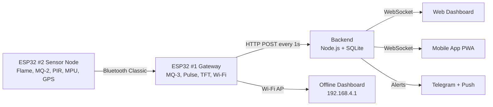

# 🚗 DriveGuard

**Every sensor. Every second. Every journey.**

DriveGuard is a real-time vehicle safety monitoring platform. Two ESP32 boards read the real world (fire, smoke, alcohol, pulse, crashes, motion, GPS) and stream it live to a web dashboard and a mobile app, with instant alerts the moment something goes wrong.

    

---

## ✨ Why DriveGuard?

A vehicle can fail you in seconds: a fire under the hood, a driver who has been drinking, a crash on an empty road. DriveGuard watches for all of it, shows it on the in-car screen, and tells the people who care, right away.

- 🔥 **Flame, smoke and alcohol detection** with instant red alerts
- 💓 **Driver pulse monitoring** (raw signal, not a medical BPM)
- 💥 **Accident detection** using an accelerometer
- 📍 **Live GPS tracking** on a map
- 📺 **In-car TFT screen** and **web dashboard** always show the same status
- 📶 **Works offline**: the car creates its own Wi-Fi dashboard at `192.168.4.1`
- 🔔 **Alerts everywhere**: dashboard siren, phone push notification, Telegram message
- 📱 **Installable app** (PWA) for Android and iOS

---

## 🧭 How it works



---

## 🔧 Hardware

### ESP32 #1: Gateway (`SAFETY_ESP32_1`)
| Part | Purpose |
|---|---|
| MQ-3 (GPIO35) | Alcohol (raw ADC, not BAC) |
| Pulse sensor (GPIO34) | Heart signal (raw, not BPM) |
| ILI9488 480x320 TFT + touch | In-car display |
| Wi-Fi | Offline AP + cloud upload |
| Bluetooth Classic | Receives data from ESP32 #2 |

### ESP32 #2: Sensor node (`SAFETY_ESP32_2`)
| Sensor | Pin |
|---|---|
| MPU (I2C, address 0x70) | SDA GPIO21, SCL GPIO22 |
| PIR motion | OUT GPIO27 |
| Flame sensor | DO GPIO26 |
| MQ-2 smoke | AO GPIO33 |
| NEO-6M GPS | GPS TX to GPIO16, GPS RX to GPIO17 |
| TCT50 control | GPIO25 |

> All sensor grounds must be common with ESP32 GND.

TFT and touch pins on ESP32 #1 are locked to the working test code. Do not change them.

---

## 📡 Bluetooth packet (ESP32 #2 to #1)

```
FLAME: NOT DETECTED
SMOKE: NOT DETECTED
MOTION: DETECTED
FREQUENCY: EMITTED
ACCIDENT: NOT DETECTED
GPS: FIXED
END
```
Only these lines are sent. Debug text stays on the Serial Monitor.

---

## 🚀 Quick start

### 1. Flash the firmware
1. Install Arduino libraries: `Arduino_GFX`, `TinyGPSPlus`.
2. Board: **ESP32 Dev Module**, Partition: **Huge APP (3MB No OTA)**.
3. Upload `firmware/esp32_node` to ESP32 #2 and `firmware/esp32_gateway` to ESP32 #1.
4. In the gateway sketch set `STA_SSID`, `STA_PASS`, `API_URL`, `API_KEY`.

### 2. Start the backend
```bash
cd backend
cp .env.example .env      # fill in secrets
npm install
npm run dev
```

### 3. Start the dashboard
```bash
cd frontend
npm install
npm run dev
```
Open `http://localhost:5173` and sign in.

Or run everything with Docker:
```bash
docker compose up --build
```

---

## 🔔 Alert logic

| Alert | Trigger | Severity |
|---|---|---|
| Flame | FLAME becomes DETECTED | Critical |
| Smoke | SMOKE becomes DETECTED | Critical |
| Accident | ACCIDENT becomes DETECTED | Critical |
| Alcohol | MQ-3 status becomes ALERT | Critical |
| Heart | Pulse status LOW or HIGH | Warning |
| Device offline | No packet for 10 s | Warning |

Repeated alerts of the same type are muted for 30 seconds.

---

## 🌐 API

| Method | Route | What it does |
|---|---|---|
| POST | `/api/telemetry` | Device uploads sensor data (needs `x-device-key`) |
| GET | `/api/latest` | Newest reading |
| GET | `/api/history` | Past readings (`from`, `to`, `limit`) |
| GET | `/api/alerts` | Alert list |
| POST | `/api/alerts/:id/ack` | Acknowledge an alert |
| GET | `/api/health` | Server health |
| WS | `/ws` | Live telemetry and alert stream |

Full docs at `/docs` (Swagger).

---

## 🛠️ Troubleshooting

**Flame sensor LED blinks but code says NOT DETECTED**
The LED does not prove what GPIO26 sees. The node firmware learns the idle level at boot, so keep the flame away while it starts. If the GPIO value never changes, check the DO wire, VCC, GND, and that DO (not AO) goes to GPIO26.

**ESP32 #1 never connects to ESP32 #2**
Confirm the MAC `14:08:08:A6:3B:56` and that ESP32 #2 is powered and advertising as `SAFETY_ESP32_2`.

**Touch feels slow**
Cloud upload runs every second; move it to its own FreeRTOS task if needed.

---

## 🗺️ Roadmap
- [ ] GPS coordinates inside the Bluetooth packet
- [ ] Trip history and reports
- [ ] Multi-vehicle fleet view
- [ ] OTA firmware updates

---

## 👤 Author
**Hari Prasath**: built with ESP32, Node.js and a lot of testing.

## 📄 License
MIT
